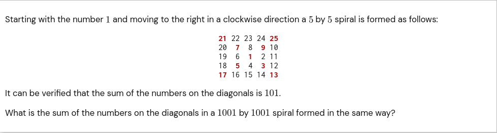

## Problem 15


This problem asks how many possible ways there are to get from the top left corner of a grid to the bottom right of the grid only being able to move right and down. We know that for any grid of size n, we will need to do exactly n moves down, and n moves to the right.   
If we represent moves to the right with the letter a, and moves down with the letter b, each path can be written in this form: aabbabbabbbaaa... This problem is then reduced to the question of how many permutations are there of 20 a's and 20 b's. The formula for this problem is  
$$\frac{n!}{n\_1! \cdot n\_2!}$$  
Where n<sub>1</sub> and n<sub>2</sub> are the number of repeating a's and b's. We can use python to find this result.
```py
import math
print(math.factorial(20)/(math.factorial(10)**2))
```

<br>

## Problem 28



My first thought when solving this problem was to first construct a 1001 by 1001 grid in the pattern described. After some more thought I realised that this was not an easy task and that there must be a better way, so I started looking for patterns.  
I noticed that the numbers on the diagonal going to the top right were perfect squares. More specifically they were 2n+1 squared where n was their "ring number", where the first ring, indexed at 0, was just 1, the second ring is numbers 2 through 9, the third ring is numbers 10 through 25 and so on. This will provide us with the numbers in the top right diagonal, but what about the others? The number in the top left is the top right number - 2\*ring number. After that, the bottom left is the top left - 2\*ring number. The same pattern can be applied for the bottom right. Putting this all together, I wrote the following c code which gave me the correct answer:  
```c
#include <stdio.h>

int main(){
        int sum = 1;
        for(int ring=1; ring<=500; ring++){
                int topright = (2*ring+1)*(2*ring+1);
                int topleft = topright-2*ring;
                int bottomleft = topleft-2*ring;
                int bottomright = bottomleft-2*ring;

                sum+=topright;
                sum+=topleft;
                sum+=bottomleft;
                sum+=bottomright;
        }
        printf("%d", sum);
}
```
