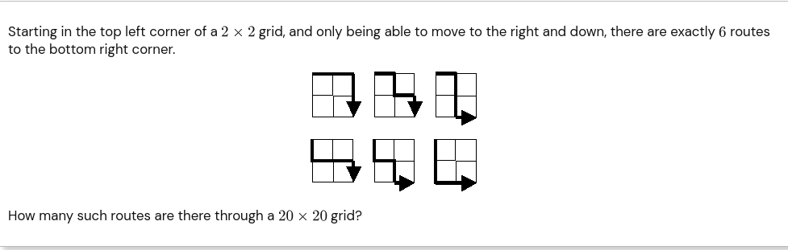

## Problem 15



This problem asks how many possible ways there are to get from the top left corner of a grid to the bottom right of the grid only being able to move right and down. We know that for any grid of size n, we will need to do exactly n moves down, and n moves to the right.   
If we repressent moves ot the right with the letter a, and moves down with the letter b, each path can be written in this form: aabbabbabbbaaa... This problem is then reduced to the question of how many permutations are there of 20 a's and 20 b's. The formula for this problem is  
$$\frac{n!}{n\_1! \cdot n\_2!}$$  
Where n<sub>1</sub> and n<sub>2</sub> are the number of repeating a's and b's. We can use python to find this result.
```py
import math
print(math.factorial(20)/(math.factorial(10)**2))
```

<br>

## Problem
